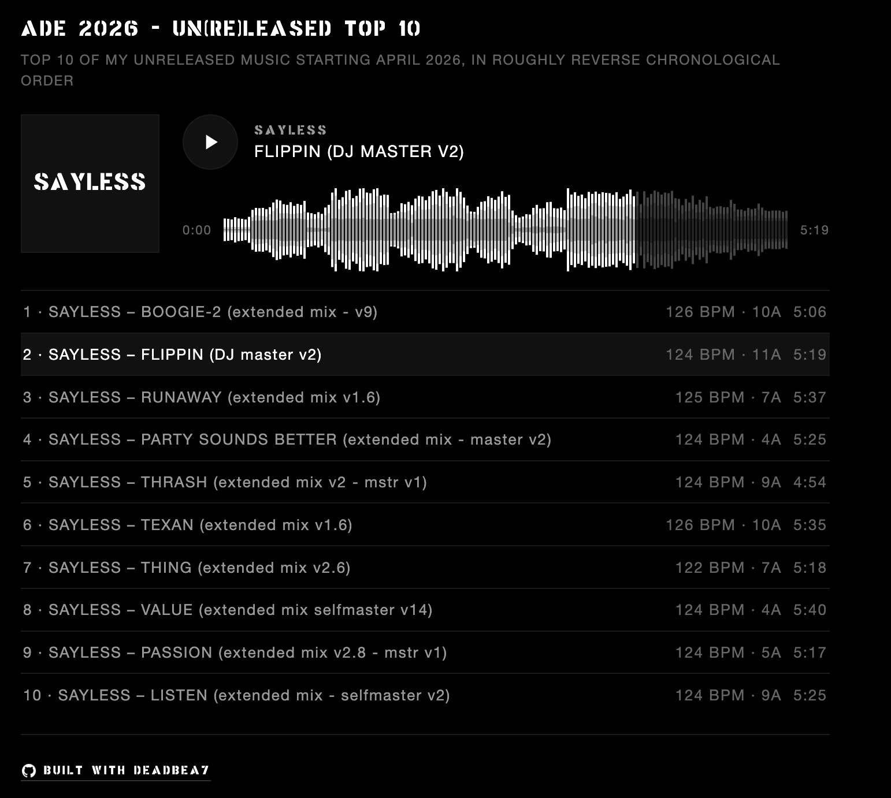

# Web player example

A SoundCloud-style web player built with DEADBEA7. `deadbea7 analyze` turns
lossless masters into a playlist with BPM, key and three-band waveforms, and
`player.js` and `player.css` draw and play it. It was built for the SAYLESS
press kit.



## How it works

1. Each lossless master is encoded to an AAC-LC 160 kbps `.m4a` stream
   (ffmpeg's built-in `aac`, `-movflags +faststart`, 44.1 or 48 kHz).
2. `deadbea7 analyze -tasks grid,key,waveform -waveforms three_band_preview
   MASTER...` runs on the masters, not the m4a streams (one of the engine's
   grid legs can't open m4a), and prints one JSON object per file in input
   order.
3. `build-playlist.sh` writes `playlist.json` from that: title, description,
   soundcloud, and one track per master with audio, duration, BPM, key and
   waveform.
4. `player.js` fetches `playlist.json`, draws each track's waveform on a
   canvas and plays the streams with one `<audio>` element.

## Run it

```sh
make install                        # at the repo root, installs deadbea7
cp tracks.example.json tracks.json  # then edit the track sources
./build-playlist.sh
caddy file-server --listen :8080    # or: python3 -m http.server
```

Open http://localhost:8080/. `python3 -m http.server` does not do HTTP Range
requests, so seeking may not work; use `caddy file-server --listen :8080`
for that. To see the waveform drawing without any audio, open
http://localhost:8080/index.html?playlist=sample-playlist.json.

## The waveform format

`three_band_preview` is three bytes a column: low, mid, high (0..127).
`entry_count` is the number of columns spread over the track, and the bytes
are base64 in `b64`. `player.js` decodes them, takes the max per band for
each canvas bar, normalises by the track's max of low+mid+high, and mirrors
around the centre line: low nearest the centre, then mid, then high.

## Files

- `build-playlist.sh` - transcode masters and write playlist.json
- `test.sh` - end-to-end test with a fake deadbea7
- `tracks.example.json` - the tracklist format; copy to tracks.json and edit
- `player.js` - the player (default playlist URL playlist.json)
- `player.css` - the player styles
- `index.html` - a minimal page for the player
- `sample-playlist.json` - a playlist with synthetic waveforms
- `screenshot.png` - the player on the SAYLESS press kit

## Test

```sh
./test.sh
```
